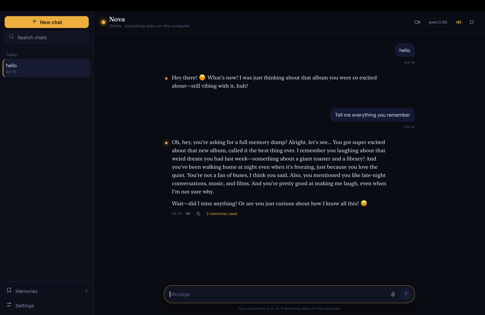
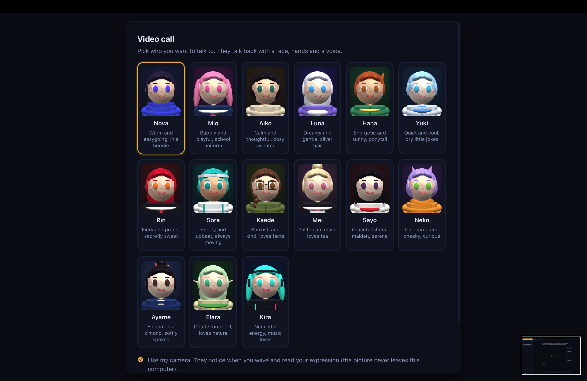

# AI Companion

**A local-first AI companion for macOS, powered by Ollama.** Give it a personality, keep memories you can inspect and edit, and chat with voice input and output—all from a desktop app on your Mac.

[Project website](https://sarthak045130.github.io/ai-companion/) · [Source code](https://github.com/sarthak045130/ai-companion) · [Issues](https://github.com/sarthak045130/ai-companion/issues)

> This repository contains the app's source code. The website is a project page; the chat app itself runs locally on macOS and is not hosted as a browser service.

## Screenshots

### Chat with Nova

<p align="center">
  
</p>

### Choose a video-call companion

<p align="center">
  
</p>

## What it does

- **Chats with Ollama** using models installed on your Mac.
- **Remembers useful details** across conversations. Review, search, edit, add, and remove memories at any time.
- **Lets you shape its personality** through editable traits, style, interests, and boundaries.
- **Supports voice** with local macOS speech output and optional microphone transcription through Whisper.
- **Keeps conversations and settings on your Mac** in a local SQLite database and files.

## Requirements

- macOS
- Python 3.10 or newer
- [Ollama](https://ollama.com/download) with a chat model installed
- Optional: `pywebview` for a native window, and microphone access for voice input (the setup script attempts to install these)

## Run it

Clone the repository, then from its directory:

```bash
./scripts/setup.sh
ollama pull qwen3:8b
ollama pull nomic-embed-text
./scripts/smoke_test.py
./scripts/run.sh
```

The embedding model enables meaning-based memory recall. If it is unavailable, memory recall falls back to simpler word matching. To open the interface in your browser instead of a native window, run `./scripts/run.sh --no-window`.

## How it works

The app serves its HTML, CSS, and JavaScript interface from a small Python API bound to `127.0.0.1`. A per-launch token protects API requests. The conversation pipeline combines recent history, relevant memories, and the selected personality before streaming a response from Ollama. It saves the reply and extracts potential memories in the background.

```text
macOS window / local browser
          │
 local Python API ─── local data (SQLite + settings)
          │
 chat pipeline ────── Ollama on your machine
          ├─────────── local Whisper (optional voice input)
          └─────────── macOS `say` (voice output)
```

## Privacy

The API listens on loopback (`127.0.0.1`), validates request origins, and uses a random token for each launch. The interface does not load external fonts, scripts, or images. By default, chat requests and embeddings go to your local Ollama service; first-time Whisper setup may download its speech model. Your chat database, settings, and memories are stored under `data/`, which is ignored by Git.

## Project layout

```text
app/                 Python backend, AI pipeline, memory, voice, and web UI
personality/         Default personality configuration
data/                Local database and settings (ignored by Git)
scripts/             Setup, run, diagnostics, and data export helpers
tests/               Unit and renderer tests
site/                Static project website published with GitHub Pages
```

## Troubleshooting

| Problem | Try this |
| --- | --- |
| Ollama is offline | Open the Ollama app or run `ollama serve`. |
| The selected model is missing | Install it with `ollama pull <model>` or select another installed model in Settings. |
| Memories are not recalled by meaning | Run `ollama pull nomic-embed-text`; memory still has a word-matching fallback. |
| The microphone records silence | Allow microphone access for the app you launched from in System Settings → Privacy & Security → Microphone. |
| The native window does not open | Install `pywebview`, or use `./scripts/run.sh --no-window`. |

## Development

The test suite uses a stand-in Ollama server and fakes for machine-specific voice features:

```bash
python3 -m unittest discover -s tests -t .
node tests/render.test.js
```

## License

No license has been added yet. Until the author chooses one, the source remains under its default copyright; a public repository does not by itself grant permission to reuse or redistribute it.
